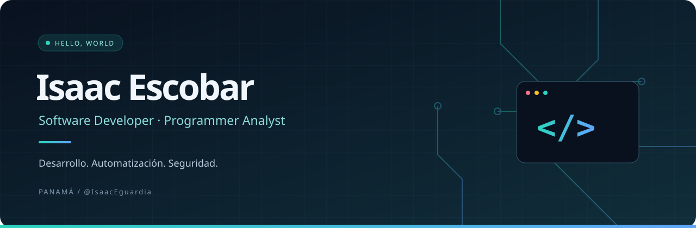

 

**Convierto ideas y procesos en soluciones digitales.**

Desarrollo web · Integración de sistemas · Automatización · Seguridad informática

🌐 **[CodeManPTY.com](https://codemanpty.com)** · [Explorar mis repositorios](https://github.com/IsaacEguardia?tab=repositories)

---

### 👋 Hola, soy Isaac

Soy **Isaac Escobar Guardia**, programador analista de Panamá, con formación en Ingeniería en Sistemas y énfasis en Seguridad Informática.

Me gusta entender cómo funciona un proceso, encontrar lo que puede mejorar y construir una solución que sea útil en el día a día. Mi trabajo combina desarrollo de aplicaciones, integración de sistemas y mantenimiento de plataformas web, con atención a la seguridad y la experiencia del usuario.

### ⚡ Lo que construyo

<table>
<tr>
<td width="33%" valign="top">

**01 / Desarrollo web**

Sitios y aplicaciones con interfaces claras, buen rendimiento y una estructura fácil de mantener.

</td>
<td width="33%" valign="top">

**02 / Automatización**

Flujos e integraciones que reducen tareas repetitivas y conectan herramientas y procesos.

</td>
<td width="33%" valign="top">

**03 / Seguridad**

Actualización de plataformas y dependencias, revisión de vulnerabilidades y mejora continua.

</td>
</tr>
</table>

### 🛠️ Tecnologías con las que trabajo

**Aplicaciones y web**

**Datos, herramientas e infraestructura**

### 🔎 Mis intereses

- **Ingeniería de software:** calidad, arquitectura y soluciones mantenibles.
- **Seguridad aplicada:** comprender vulnerabilidades y fortalecer aplicaciones.
- **IA y automatización:** explorar herramientas que aporten valor a procesos reales.
- **Productos digitales:** unir diseño, tecnología y necesidades del negocio.

---

**Entender el problema. Construir la solución. Seguir mejorando.**

Hecho desde Panamá 🇵🇦

